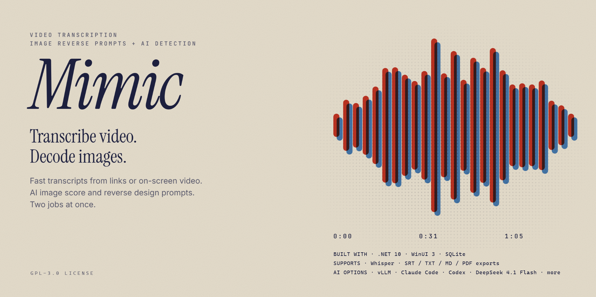

# Mimic



> **Turn any video or picture into a titled, timestamped note, on your own Windows PC, with no subscription.**


Mimic is a small Windows desktop app built with .NET 10, WinUI 3 and the Windows App SDK. Paste a link, or point a crosshair at a video that has no link, and Whisper writes the transcript on your own machine. A model of your choice then titles every section, and one click saves it all as Markdown for your vault or note program.

## Install

1. Download **Mimic_0.3.0_x64-setup.exe** from the [latest release](https://github.com/soybean-alien/Mimic/releases/latest). It is about 7 MB.
2. Run it. Windows may show a "Windows protected your PC" box because the installer is not signed; choose **More info**, then **Run anyway**.
3. Open Mimic and click **Download tools**, then **Download Whisper model**.

New here? Read [START HERE.md](START%20HERE.md), a step-by-step guide in plain English.

## What the installer contains, and what it downloads

The installer contains only Mimic itself. Everything else is downloaded when it is needed:

| Item | Size (estimated) | When it is downloaded |
| --- | --- | --- |
| .NET 10 Runtime, x64 (Microsoft) | 30 MB | Only if this PC does not have it: setup opens [Microsoft's download page for it](https://dotnet.microsoft.com/en-us/download/dotnet/thank-you/runtime-10.0.14-windows-x64-installer) in your browser and waits while you install it |
| Windows App Runtime 2.6 (Microsoft) | 125 MB | Only if this PC does not have it: setup opens Microsoft's download in your browser and waits while you install it |
| yt-dlp | 23 MB | In Mimic, the first time it is needed |
| FFmpeg and ffprobe | 193 MB | In Mimic, the first time it is needed |
| Whisper engine (whisper.cpp) | 10 MB | In Mimic, the first time it is needed |
| **Whisper model** (`ggml-large-v3-turbo-q5_0.bin`) | 574 MB | **Optional. Only when you choose to download it in Mimic** |

**The Whisper model is not in the installer.** Mimic needs it to transcribe, so the first time you transcribe (or when you open **Downloads** from the missing-tools notice at startup) Mimic offers to download it. The download is checked against its SHA-1 before it is used. If the model is already in `%USERPROFILE%\Mimic\models`, Mimic uses it and downloads nothing.

The simple way is two clicks in Mimic's **Downloads** box: **Download tools**, then **Download Whisper model**. To fetch the files yourself instead, the Downloads box links to each one. The two single-file downloads are:

- Whisper model: <https://huggingface.co/ggerganov/whisper.cpp/resolve/main/ggml-large-v3-turbo-q5_0.bin>, saved in `%USERPROFILE%\Mimic\models`
- yt-dlp: <https://github.com/yt-dlp/yt-dlp/releases/latest/download/yt-dlp.exe>, saved in `%USERPROFILE%\Mimic\tools\yt-dlp`

Reading, exporting and playing transcripts you already have works without any of the downloads. Tools already in `%USERPROFILE%\Mimic\tools` are used as they are, including a GPU Whisper engine if you put one there; the engine Mimic downloads itself is the CPU build.

## Features

- **Transcribe from a link.** yt-dlp fetches the audio and whisper.cpp transcribes it on your machine.
- **Embedded video extraction.** Point a crosshair at a video on your screen, link or no link. Mimic tries available video sources, reports extraction attempts and results, and falls back to listening to the window when video extraction fails. Listening runs in real time.
- **Drop a file.** Drop a video or audio file on the window to transcribe it, or a picture to describe it.
- **Video length and host.** Shows the video duration and sanitized hosting names when the source provides them.
- **Local video playback.** Plays saved video downloads from the transcript; timestamps jump to the matching section.
- **Progress and timer.** A progress bar and timer run while video jobs are working.
- **Key takeaways by topic.** Timestamped topic sections with supporting details.
- **Section titles.** Every timestamp gets a short title saying what that section covers.
- **Save .md.** A note with frontmatter, a heading per section, and timestamps that link back to that second on YouTube. Direct Obsidian saving uses the `MIMIC_OBSIDIAN_VAULT` path supplied when Mimic starts; Mimic does not guess a vault location. If the destination contains `.obsidian`, Mimic asks before writing.
- **More exports.** Copy, Save .srt, Save .txt and Export PDF.
- **Pictures.** Browse to an image for a very detailed reverse prompt, plus an AI score in one of six tiers of certainty. The score is a model's opinion, not a measured detector.
- **Two tabs.** Run two jobs side by side, each with an MM:SS stopwatch.
- **A local library.** Everything you make stays in a SQLite file on your PC.
- **Open Stored files.** Opens Mimic's local video downloads folder in Explorer.
- **Change library folder.** Pick your own folder for the library (`library.db` and pictures). Mimic copies the current library there if the folder has none, then restarts. Tools and models always stay in `%USERPROFILE%\Mimic`.
- **Update yt-dlp.** One button in the sidebar.

## Choose your model

Whisper always does the transcribing. The **Model** button picks what writes the titles, reverse prompts and score:

| Choice | Where your text and images go | What it needs |
| --- | --- | --- |
| Default: Haiku for titles, Sonnet for images | Anthropic | The Claude Code command |
| One Claude model for everything | Anthropic | The Claude Code command |
| OpenAI | OpenAI | The Codex command, signed in with your ChatGPT account; no API key |
| DeepSeek | DeepSeek | An API key |
| Ollama, LM Studio or another address | Your own server | A running server and model |

Those sign-ins, keys and servers are not bundled. A new install starts on Default, signed out of everything.

## Build from source

You only need this to change Mimic; to use it, download the installer above.

You need the .NET 10 SDK. Build output goes to `%USERPROFILE%\Mimic\build\winui`, outside the source tree.

```bash
dotnet build Mimic/Mimic.csproj -c Release -p:Platform=x64
```

```bash
dotnet test Mimic.Tests/Mimic.Tests.csproj
```

To pack the installer you also need [NSIS 3](https://nsis.sourceforge.io/Download). The script finds `makensis.exe` in NSIS's default install folder or on PATH; for any other location pass `-MakeNsis <path>`:

```bash
powershell -ExecutionPolicy Bypass -File installer/build.ps1
```

The installer is written to `%USERPROFILE%\Mimic\build\winui\installer`.

## Good to know

- Mimic keeps its data in `%USERPROFILE%\Mimic`: `library.db`, images, tools and models. Uninstalling removes only the program files; the library, tools, models and saved videos stay.
- API keys for the address route are stored as plain text in `library.db`.
- Whisper is unreliable on music and makes mistakes on poor audio.
- Playing a video faster while Embedded listens compresses its timestamps.

## Credits and AI disclosure

- Made by **soybean_alien**. Licensed under the **GNU General Public License v3.0** (see [LICENSE](LICENSE)).
- [.NET](https://github.com/dotnet/runtime), [Windows App SDK and WinUI 3](https://github.com/microsoft/WindowsAppSDK), [Microsoft.Data.Sqlite](https://github.com/dotnet/efcore), [yt-dlp](https://github.com/yt-dlp/yt-dlp), [FFmpeg](https://ffmpeg.org) and [whisper.cpp](https://github.com/ggml-org/whisper.cpp).
- Mimic is an unofficial personal project and isn't affiliated with Anthropic, OpenAI, DeepSeek or Microsoft.
- **AI disclosure:** Mimic was designed with and written by **Claude Code (Anthropic, Claude Fable 5.2)**, directed and tested by the author. Run in the real app before release: opening a library, transcript and picture views, the video player, the Model dialog, the Downloads box and changing the library folder. Covered by automated tests only: link and file transcription, tool downloads, exports and PDF. Not yet run in the real app: Embedded capture, the AI routes, OpenAI sign-in and a fresh install on a PC without the runtimes.
